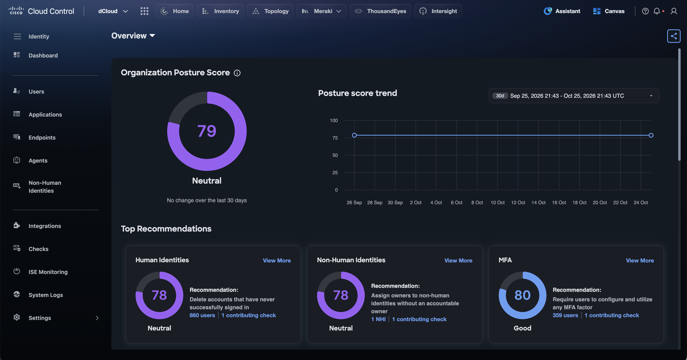
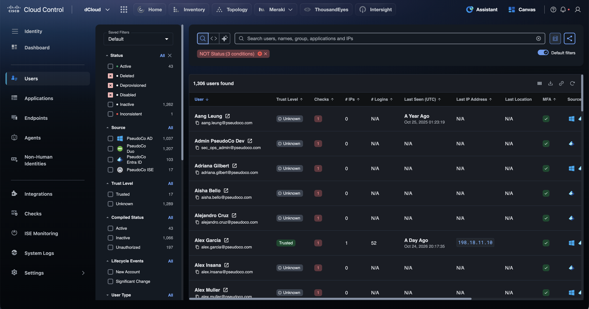
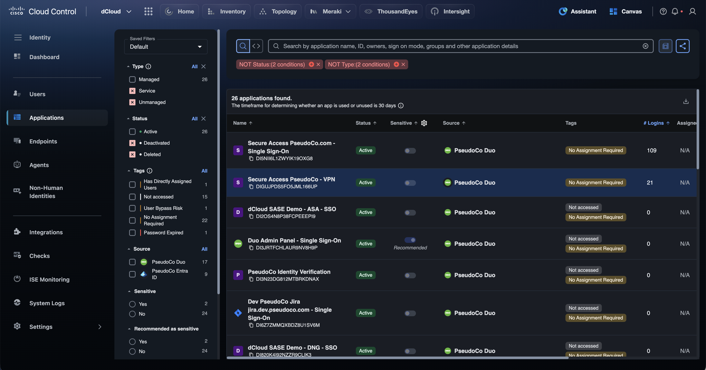
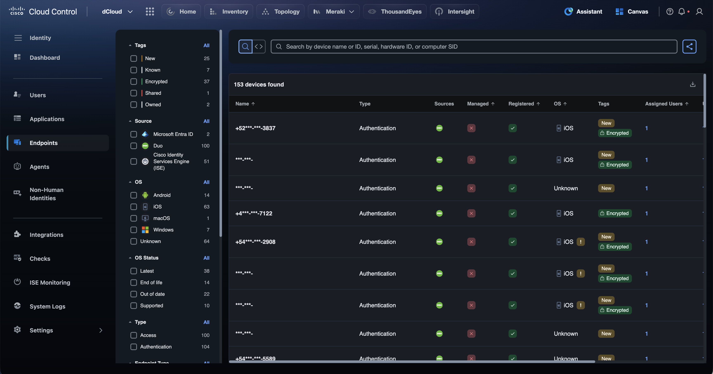
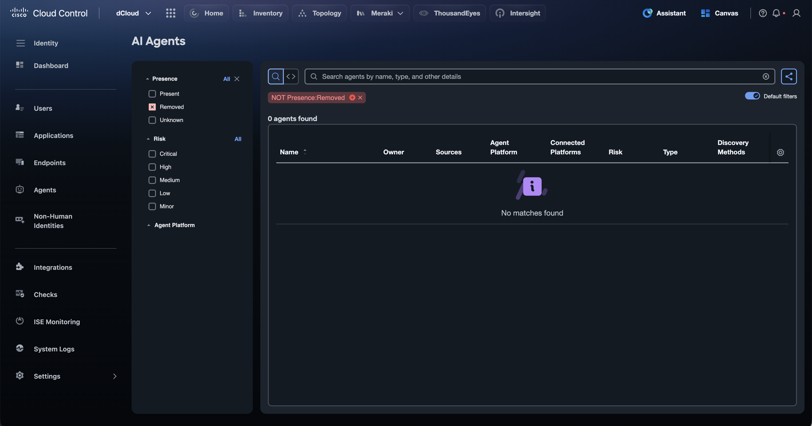
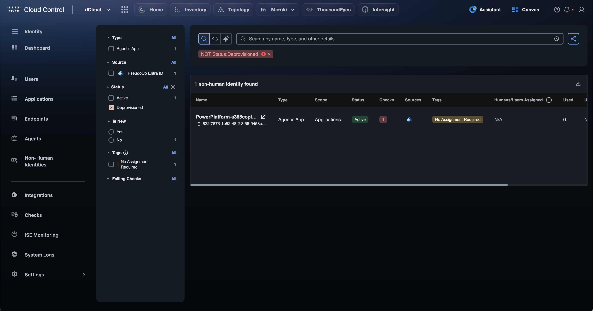
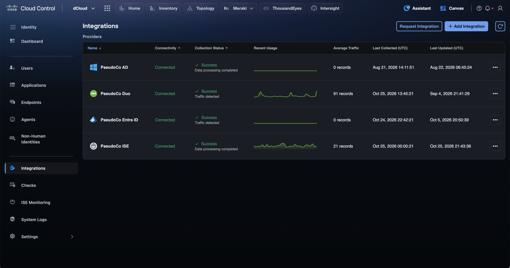
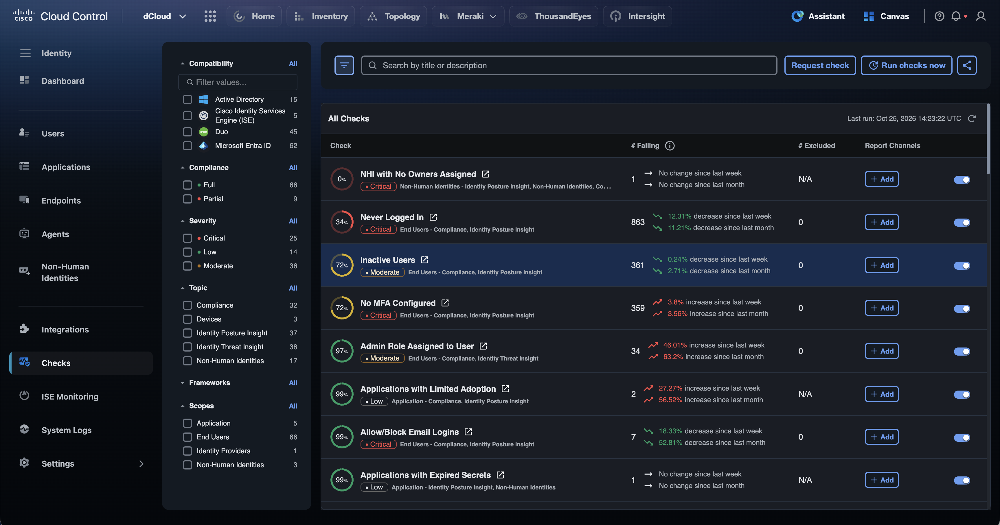
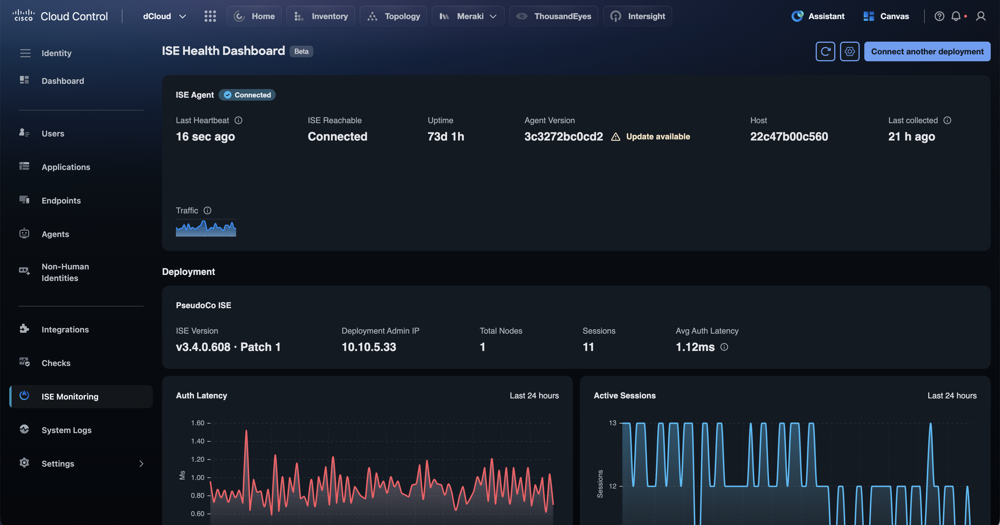
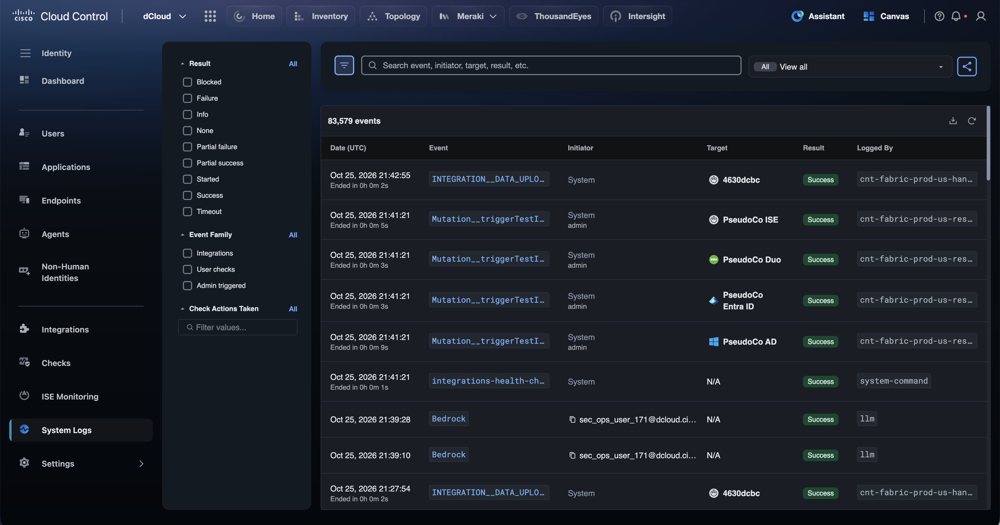

# Section 3: Identity

In this section, you will explore Identity Intelligence in Cisco Cloud Control. You will review the identities in the environment — users, endpoints, agents, and non-human identities — and see how trust levels, identity checks, and MFA posture surface risky accounts before they become incidents.

## Step 5: Open Identity Intelligence and Review the Posture Dashboard

From the Cloud Control top bar, open the **9-Dot Menu** and select **Identity**. The Identity Intelligence **Dashboard** opens by default.

The Dashboard answers one question: *how healthy is the identity posture of this organization right now?*

- **Organization Posture Score** — a single 0–100 score (79, *Neutral* in this lab) rolled up from every identity check across all connected identity sources.

- **Posture score trend** — how the score has moved over the selected window (30 days by default), so you can tell whether remediation work is paying off.

- **Top Recommendations** — per-category scores for **Human Identities**, **Non-Human Identities**, and **MFA**, each with the single highest-impact fix, how many identities it affects, and the checks that contribute to it.

!!! tip "Tip"
    Click any **users** or **contributing check** link on a recommendation card to jump straight to the filtered list of affected identities.

## Step 6: Explore Users

In the left navigation, click **Users**.

Users is a single, correlated inventory of every human identity, regardless of where the account lives. In this lab, accounts from **PseudoCo AD**, **PseudoCo Duo**, **PseudoCo Entra ID**, and **PseudoCo ISE** are merged into one record per person.

- **Trust Level** — whether the identity is *Trusted* or *Unknown* based on its behavior and posture.

- **Checks** — the number of failing identity checks for that user.

- **# IPs, # Logins, Last Seen, Last IP Address, Last Location** — recent authentication activity.

- **MFA** and **Source** — whether MFA is enrolled and which identity providers hold the account.

Use the filter panel on the left (Status, Source, Trust Level, Compiled Status, Lifecycle Events, User Type) to slice the population, and the search bar to find a user by name, group, application, or IP.

!!! info "Note"
    **Default filters** hide deleted, deprovisioned, and disabled accounts. Toggle **Default filters** off to see the full population.

## Step 7: Explore Applications

Click **Applications**.

Applications lists every application your identity providers authenticate users into — here, the Duo and Entra ID SSO applications such as Secure Access, dCloud SASE demos, and Jira.

- **Status** and **# Logins** — whether the app is active and actually used (the usage window is 30 days).

- **Sensitive** — mark business-critical apps as sensitive; Cloud Control also *recommends* apps that look sensitive.

- **Tags** — risk signals such as *Not accessed*, *No Assignment Required*, *User Bypass Risk*, or *Password Expired*.

!!! tip "Tip"
    An app tagged **No Assignment Required** can be reached by any user in the directory. Combine that tag with **Sensitive = Yes** to find your highest-risk applications.

## Step 8: Explore Endpoints

Click **Endpoints**.

Endpoints shows the devices your users authenticate from, correlated from **Duo**, **Microsoft Entra ID**, and **Cisco ISE**.

- **Managed** and **Registered** — whether the device is under management and registered with an identity provider.

- **OS** and **OS Status** — platform and patch state (*Latest*, *Out of date*, *End of life*).

- **Tags** — *New*, *Known*, *Encrypted*, *Shared*, *Owned*.

- **Assigned Users** — who uses the device, linking device risk back to the identity.

!!! info "Note"
    Phone-number device names are masked automatically to protect personal data.

## Step 9: Explore AI Agents

Click **Agents**.

AI Agents is the inventory of AI agents operating in your environment, treated as identities in their own right. For each agent you can see its **Owner**, **Sources**, **Agent Platform**, **Connected Platforms**, **Risk** level (Critical to Minor), **Type**, and how it was discovered.

As teams adopt agentic tools, this view answers who owns each agent, what it can reach, and how risky it is.

!!! info "Note"
    No AI agents are present in this lab tenant, so the list is empty.

## Step 10: Explore Non-Human Identities

Click **Non-Human Identities**.

Non-Human Identities (NHIs) are service accounts, service principals, and agentic apps that authenticate without a person behind them. They are often over-privileged and unowned, which makes them a favorite target.

This lab has one NHI: a **PowerPlatform** agentic app from Entra ID. Note its failing check and the **Humans/Users Assigned** column showing *N/A*: nobody owns it.

!!! tip "Tip"
    This NHI is the one behind the Dashboard recommendation *“Assign owners to non-human identities without an accountable owner.”*

## Step 11: Review Integrations

Click **Integrations**.

Integrations shows the identity sources that feed Identity Intelligence. This lab connects four providers: **PseudoCo AD**, **PseudoCo Duo**, **PseudoCo Entra ID**, and **PseudoCo ISE**.

For each one, check **Connectivity**, **Collection Status**, **Recent Usage**, and **Last Collected** to confirm data is flowing. Every other Identity page is built from these sources.

!!! warning "Caution"
    Do not add, edit, or remove integrations in this shared lab tenant.

## Step 12: Explore Identity Checks

Click **Checks**.

Checks are the continuous tests that drive every score you have seen. Each check shows:

- **Pass rate** (the ring), **severity** (Critical, Moderate, Low), and its scope and topic (for example *End Users – Compliance, Identity Posture Insight*).

- **# Failing**, with the week-over-week and month-over-month trend.

- **Report Channels** — where alerts for that check are sent.

Examples in this lab include *NHI with No Owners Assigned*, *Never Logged In*, *Inactive Users*, *No MFA Configured*, and *Admin Role Assigned to User*. Use the filters to narrow checks by compatible source, compliance, severity, topic, framework, or scope.

!!! warning "Caution"
    Leave **Run checks now**, the enable toggles, and **Report Channels** unchanged in this shared tenant.

## Step 13: Monitor ISE Health

Click **ISE Monitoring**.

The **ISE Health Dashboard** (Beta) monitors the on-premises Cisco ISE deployment through a lightweight **ISE Agent**:

- **ISE Agent** — connection status, last heartbeat, uptime, agent version, and whether an update is available.

- **Deployment** — ISE version and patch, admin IP, node count, active sessions, and average authentication latency.

- **Auth Latency** and **Active Sessions** charts for the last 24 hours.

This brings on-prem ISE health into the same cloud console as the rest of your identity estate.

## Step 14: Audit Activity in System Logs

Click **System Logs**.

System Logs is the audit trail for Identity Intelligence: integration data uploads, admin-triggered actions such as integration tests, check runs, and AI requests. Each event records its **Initiator**, **Target**, **Result**, and the component that logged it.

Filter by **Result** (for example *Failure* or *Timeout*) or **Event Family** (Integrations, User checks, Admin triggered) to troubleshoot collection problems or see who changed what.

!!! abstract "Congratulations"
    You have completed the Identity section. You toured the full Identity Intelligence workflow: posture scoring, human and non-human identity inventories, applications and endpoints, the checks behind every score, ISE health, and the audit trail.
