# Section 4: Splunk Secure Networking App

In this section, you will explore Splunk Secure Networking Essentials (SSNE), the Splunk app built into Cisco Cloud Control. SSNE correlates telemetry from Cisco ISE, Duo, Secure Access, Secure Firewall, Meraki, Catalyst Center, Catalyst SD-WAN, Nexus Dashboard, ACI, ThousandEyes, XDR, and AI Defense into executive workspaces and investigation dashboards organized around five secure-networking pillars: Zero Trust Access, Secure Infrastructure, Scalable Network Segmentation, Hybrid Mesh Firewalling, and Agentic Ops.

## Step 1: Launch Splunk Secure Networking Essentials

From the Cloud Control top bar, open the **9-Dot Menu** and click **Splunk**. Splunk Cloud opens inside Cloud Control on the **Splunk Secure Networking Essentials** **Insights Workspace**.

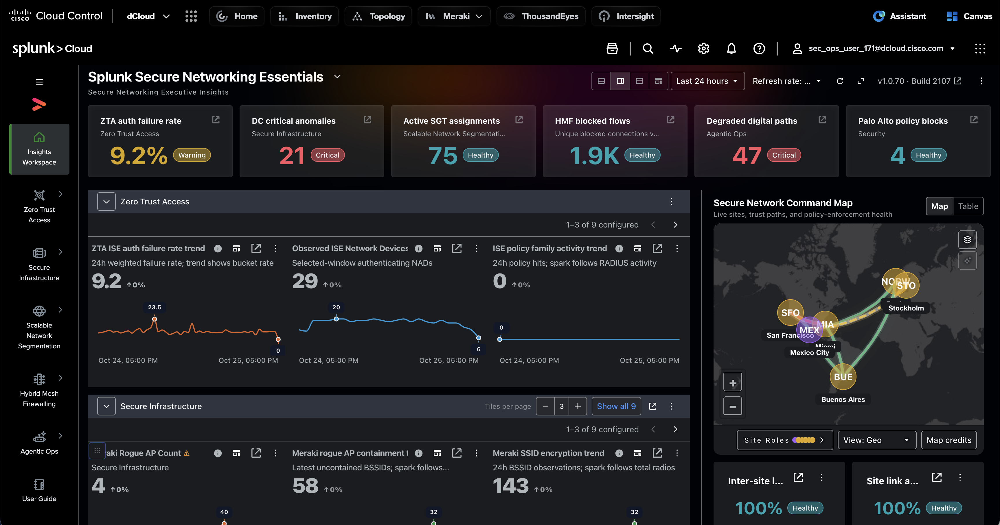

The Insights Workspace is the executive starting point for the whole app:

- **Headline tiles** — one health signal per pillar, each with a status badge (*Healthy*, *Warning*, *Critical*): ZTA auth failure rate, DC critical anomalies, active SGT assignments, Hybrid Mesh Firewall blocked flows, degraded digital paths, and Palo Alto policy blocks.

- **Pillar rows** — collapsible Zero Trust Access, Secure Infrastructure, and other rows of trend tiles. Page through them with the arrows, or change how many tiles show per page.

- **Secure Network Command Map** — live sites, trust paths, and policy-enforcement health on a geographic map (switch to *Table* for a list), with inter-site and site-link availability below it.

- **Controls** — layout toggles, time range (default *Last 24 hours*), and refresh rate.

The left navigation groups every dashboard by pillar. Hover a pillar to open its dashboards.

!!! tip "Tip"
    Click the **open** icon on any headline tile to jump straight to the dashboard behind that number.

## Step 2: Zero Trust Access

In the left navigation, hover **Zero Trust Access** and open each dashboard in turn. This pillar answers: *are the right users and devices getting access, and are policies being enforced?*

### Zero Trust Posture

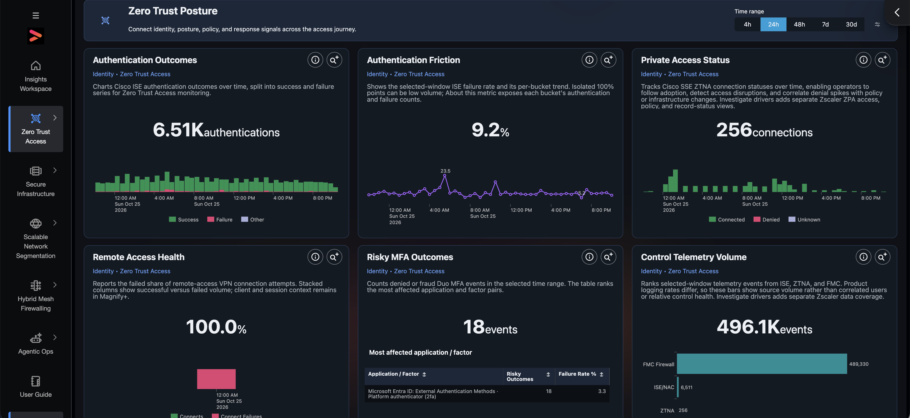

The pillar summary. It connects identity, posture, policy, and response signals across the access journey: ISE **Authentication Outcomes** and **Friction** (failure rate), Secure Access ZTNA **Private Access Status**, **Remote Access Health**, Duo **Risky MFA Outcomes** ranked by application and factor, and **Control Telemetry Volume** from ISE, ZTNA, and FMC.

### Authentication and Policy Enforcement

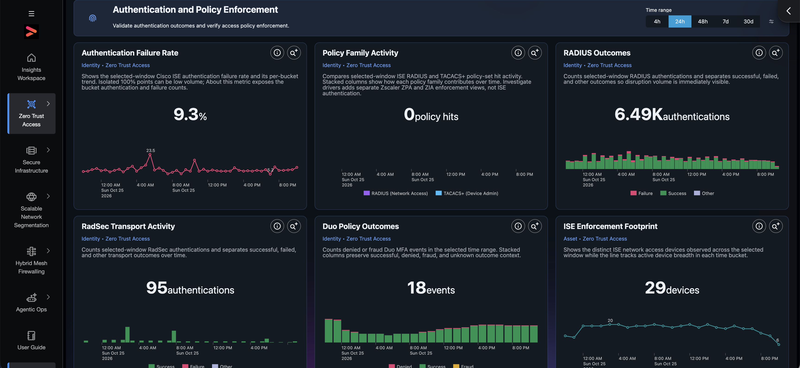

Validates that authentication works and policy is applied: ISE failure rate, RADIUS vs TACACS+ **Policy Family Activity**, **RADIUS Outcomes**, **RadSec Transport Activity**, **Duo Policy Outcomes** (denied, success, fraud), and the **ISE Enforcement Footprint** — how many network access devices are actively enforcing.

### Policy Management

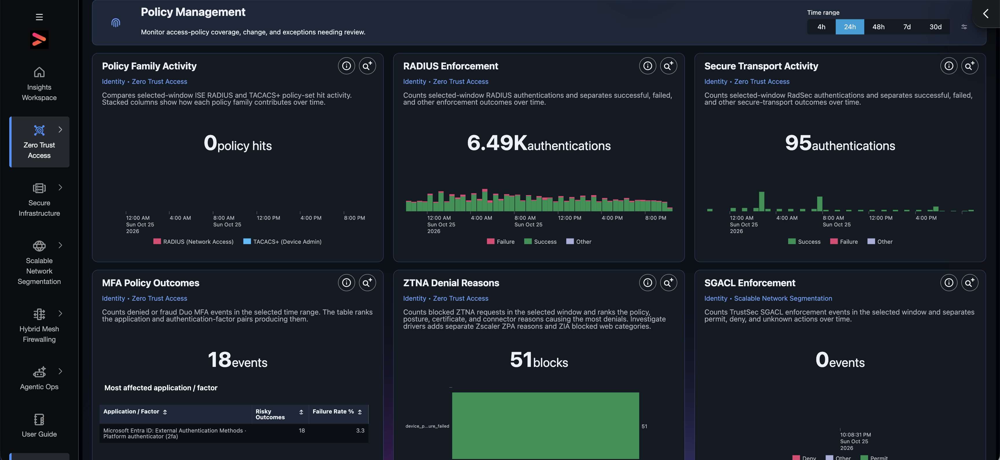

Monitors access-policy coverage, change, and exceptions that need review: RADIUS enforcement, secure transport, MFA policy outcomes, **ZTNA Denial Reasons** (which policy, posture, certificate, or connector reason is blocking users), and TrustSec **SGACL Enforcement**.

### User Activity Monitoring

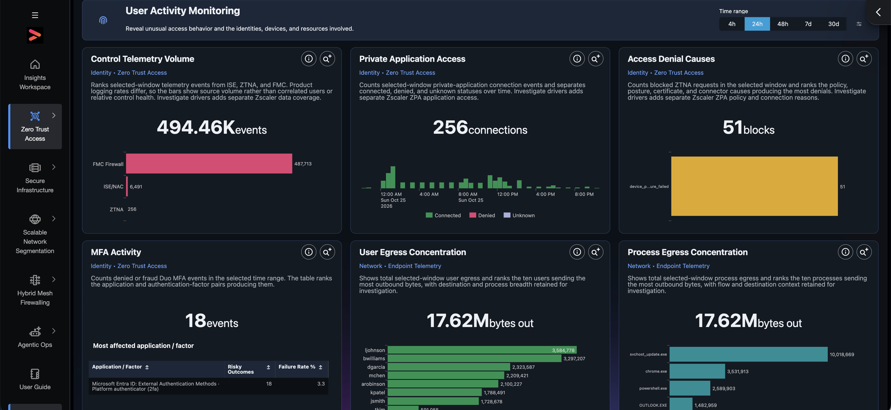

Reveals unusual access behavior and the identities, devices, and resources involved: private application access, access denial causes, MFA activity, and — from endpoint telemetry — **User** and **Process Egress Concentration**, which rank the users and processes sending the most data out.

### Detection & Response

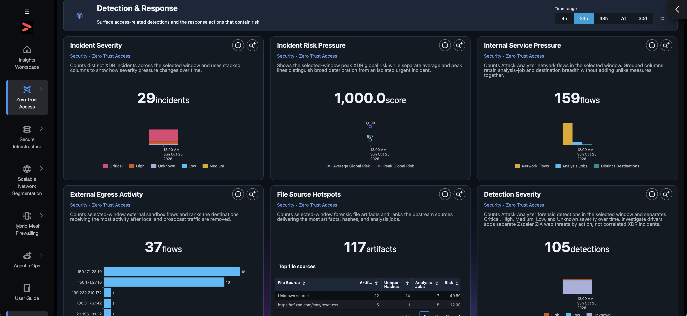

Surfaces access-related detections and the response actions that contain risk: Cisco XDR **Incident Severity** and **Incident Risk Pressure**, Attack Analyzer flows and forensic detections, **External Egress Activity** by destination, and **File Source Hotspots**.

### Remote Access VPN (RaVPN) Sessions and Posture

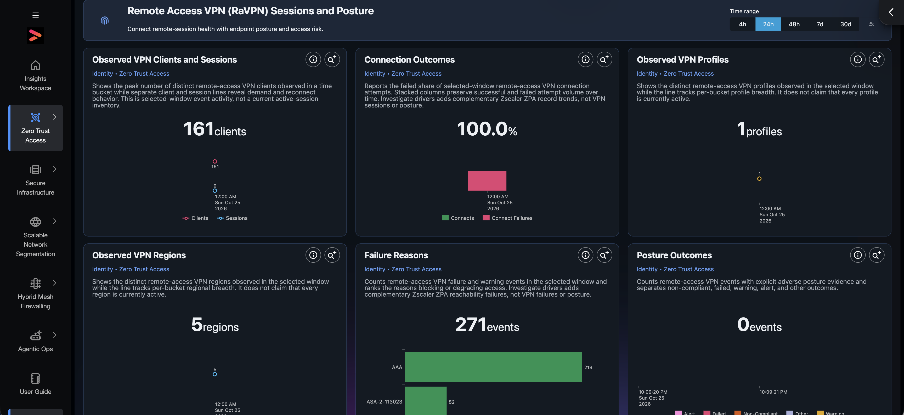

Connects remote-session health with endpoint posture and access risk: VPN clients and sessions, connection outcomes, VPN profiles and regions in use, ranked **Failure Reasons**, and **Posture Outcomes** (non-compliant, failed, warning).

!!! info "Note"
    Each panel shows its data domain and pillar under the title (for example *Identity · Zero Trust Access*), and its description states exactly what is — and is not — being counted.

## Step 3: Secure Infrastructure

Hover **Secure Infrastructure**. This pillar answers: *is the network and data center healthy, and where is it exposed?*

### Secure Infrastructure Status

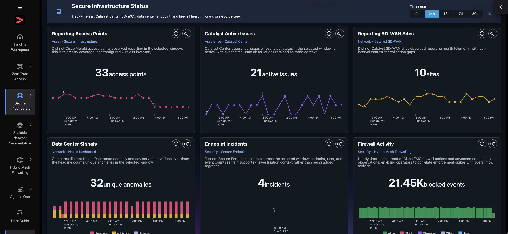

One cross-source health view of wireless, Catalyst Center, SD-WAN, data center, endpoint, and firewall: Meraki **Reporting Access Points**, **Catalyst Active Issues**, **Reporting SD-WAN Sites**, Nexus Dashboard **Data Center Signals**, Secure Endpoint **Endpoint Incidents**, and FMC **Firewall Activity**.

### Infrastructure Posture

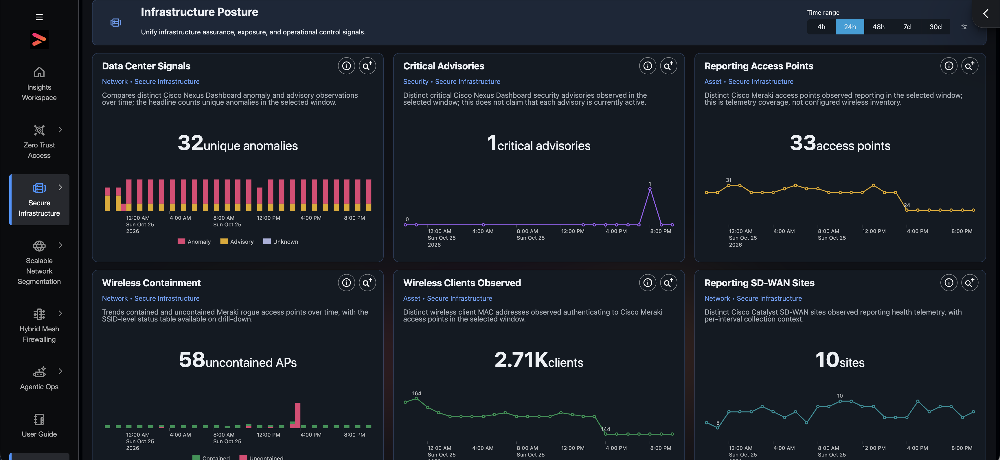

Unifies assurance, exposure, and operational control signals: data center anomalies, Nexus Dashboard **Critical Advisories**, Meraki **Wireless Containment** of rogue access points, **Wireless Clients Observed**, and SD-WAN site reporting.

### Secure Data Center Operations

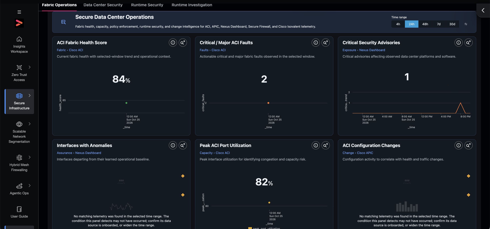

Fabric health, capacity, policy enforcement, runtime security, and change intelligence for ACI, APIC, Nexus Dashboard, Secure Firewall, and Cisco Isovalent. Tabs across the top switch between **Fabric Operations**, **Data Center Security**, **Runtime Security**, and **Runtime Investigation**. Fabric Operations shows the **ACI Fabric Health Score**, critical and major ACI faults, security advisories, interface anomalies, peak port utilization, and ACI configuration changes.

### SD-WAN and Network Health Monitoring

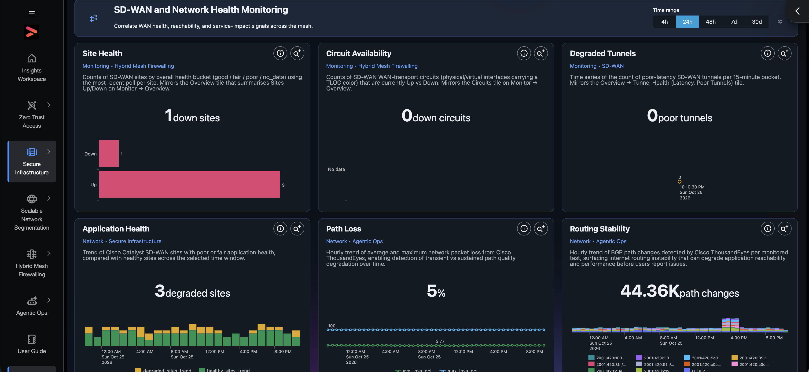

Correlates WAN health, reachability, and service impact: SD-WAN **Site Health**, **Circuit Availability**, **Degraded Tunnels**, **Application Health**, and ThousandEyes **Path Loss** and BGP **Routing Stability**.

!!! info "Note"
    Panels with no data in the selected window say so explicitly and suggest checking that the data source is onboarded or widening the time range.

## Step 4: Scalable Network Segmentation

Hover **Scalable Network Segmentation**. This pillar answers: *how far has TrustSec/SGT segmentation been adopted, and is it being enforced?*

### Segmentation Readiness

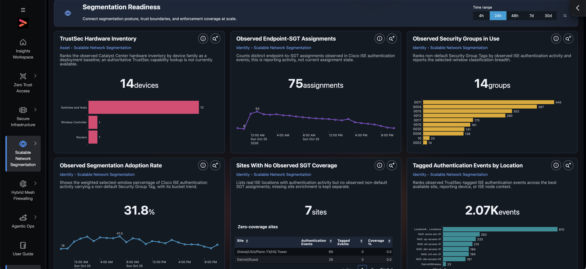

Connects segmentation posture, trust boundaries, and enforcement coverage: the TrustSec-capable **Hardware Inventory**, endpoint-to-SGT assignments, which **Security Groups** are in use, the **Segmentation Adoption Rate**, **Sites With No Observed SGT Coverage**, and tagged authentication events by location.

### Segmentation Operations

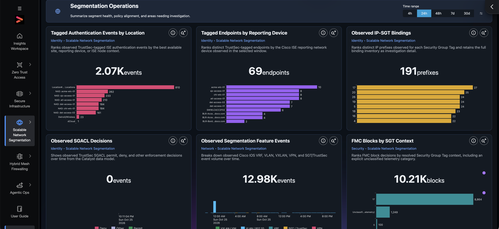

Summarizes segment health, policy alignment, and areas needing investigation: tagged endpoints by reporting device, **IP-SGT Bindings**, **SGACL Decisions** (permit, deny), VRF / VLAN / VXLAN / SGT feature events, and **FMC Blocks by SGT Context** — where firewall policy is acting on group tags.

!!! tip "Tip"
    Use **Sites With No Observed SGT Coverage** as a rollout checklist: each listed site authenticates users but never assigns a non-default Security Group Tag.

## Step 5: Hybrid Mesh Firewalling

Hover **Hybrid Mesh Firewalling**. This pillar answers: *is policy enforced consistently across every firewall — on-prem, branch, cloud, and workload?*

### Hybrid Mesh Enforcement

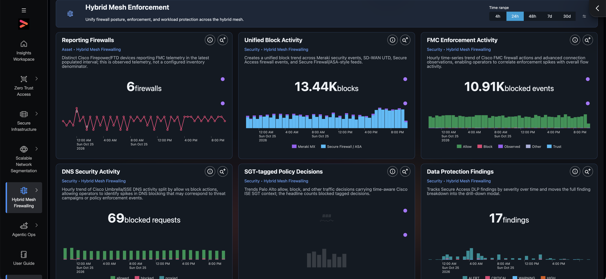

Unifies firewall posture, enforcement, and workload protection: **Reporting Firewalls**, **Unified Block Activity** across Meraki MX and Secure Firewall/ASA, FMC enforcement, Umbrella/SSE **DNS Security Activity**, Palo Alto **SGT-tagged Policy Decisions**, and Secure Access DLP findings.

### Threat Detection and Enforcement

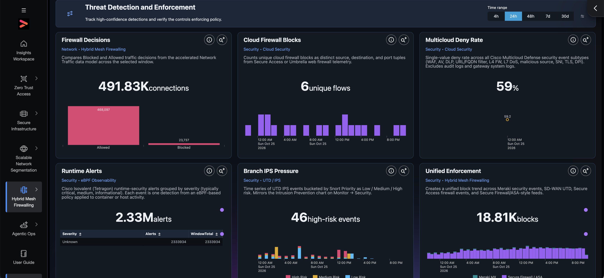

Tracks high-confidence detections and the controls enforcing policy: allowed vs blocked **Firewall Decisions**, **Cloud Firewall Blocks**, the Multicloud Defense **Deny Rate**, Isovalent **Runtime Alerts**, **Branch IPS Pressure** from SD-WAN UTD, and a unified enforcement trend.

### DLP and Cloud Native Security

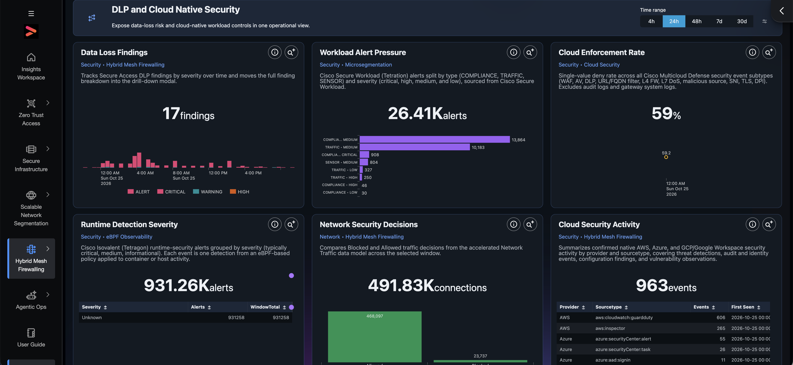

Exposes data-loss risk and cloud-native workload controls: **Data Loss Findings** by severity, Secure Workload **Workload Alert Pressure**, the cloud enforcement rate, runtime detection severity, and native AWS / Azure / GCP **Cloud Security Activity**.

## Step 6: Agentic Ops

Hover **Agentic Ops**. This pillar answers: *are users getting a good digital experience, and what should operators and executives act on first?*

### Operational Intelligence

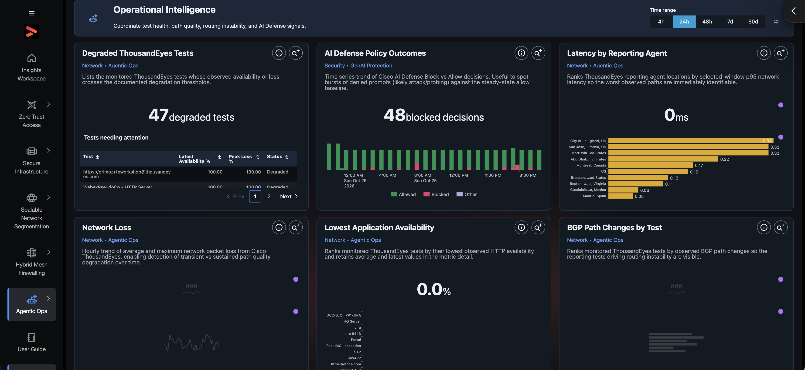

Coordinates test health, path quality, routing instability, and AI Defense signals: **Degraded ThousandEyes Tests** with a table of tests needing attention, **AI Defense Policy Outcomes** (blocked vs allowed prompts), latency by reporting agent, network loss, lowest application availability, and BGP path changes by test.

### Secure Networking Assurance

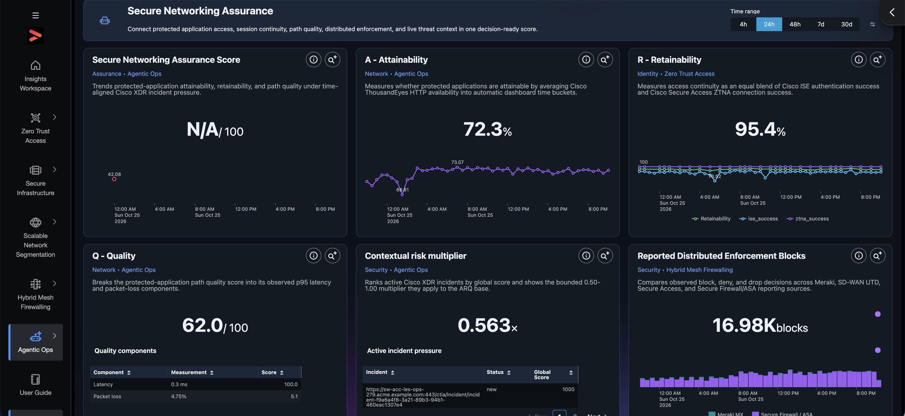

Rolls protected-application access into one decision-ready **Secure Networking Assurance Score** built from **A**ttainability (ThousandEyes HTTP availability), **R**etainability (ISE and ZTNA success), and **Q**uality (latency and packet loss), adjusted by a **Contextual risk multiplier** from active XDR incidents.

### Executive Assurance

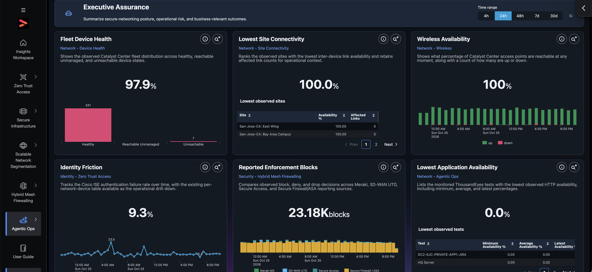

Summarizes posture, operational risk, and business-relevant outcomes for leadership: **Fleet Device Health**, lowest site connectivity, wireless availability, identity friction, reported enforcement blocks, and lowest application availability.

!!! info "Note"
    If the assurance score shows *N/A*, one of its inputs had no data in the selected window. Widen the time range to see the trend.

## Step 7: Investigate Any Panel

Every panel has two icons in its top-right corner:

- **ⓘ** — what the panel measures and how to read it.

- **Search** (magnifier) — opens the panel's exact search, with the active time range, in Splunk Search, so you can pivot from any number to the raw events behind it.

Use the **Time range** buttons (4h, 24h, 48h, 7d, 30d) at the top of each dashboard to change the window.

!!! abstract "Congratulations"
    You have completed the Splunk Secure Networking App section. You explored the Insights Workspace and all five secure-networking pillars, and learned how to drill from any metric to its underlying search.
