# Section 5: Studio

Cisco Cloud Control Studio is the extensibility, governance, and customization engine of the Cisco Cloud Control platform. Part of Cisco's AgenticOps strategy, it gives IT and security operations teams a design space to build autonomous AI agents and applications that bridge Cisco infrastructure and third-party tools. In this section, you will use its two environments — App Builder and Agent Builder — and see how everything built in Studio is governed by AI Defense guardrails, traced through Splunk AI Agent Monitoring, and published for use across the platform.

## Step 1: Open Cloud Control Studio

From the Cloud Control top bar, open the **9-Dot Menu** and, under **Platform Services**, click **Studio**.

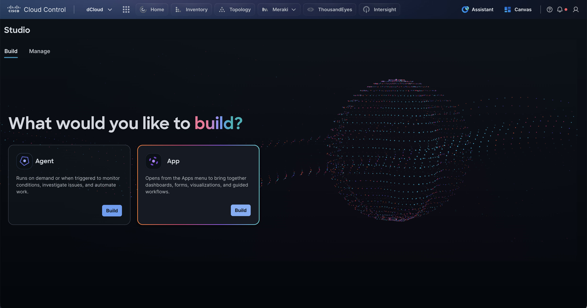

Studio has two tabs:

- **Build** — start something new. Choose an **Agent**, which runs on demand or when triggered to monitor conditions, investigate issues, and automate work, or an **App**, which opens from the Apps menu and brings together dashboards, forms, visualizations, and guided workflows.

- **Manage** — every agent and app you have built, with its type, status, and version.

You will build an agent first, then an app.

## Step 2: Shape an Agent with Agent Builder

On the **Agent** card, click **Build**.

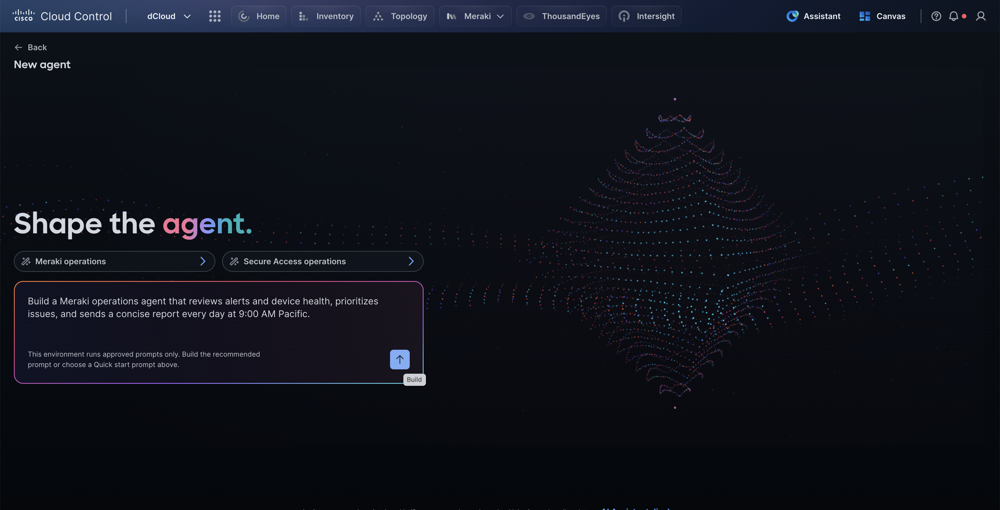

Agent Builder lets you engineer an AI agent for your own workflows, troubleshooting paths, and policies by **describing the behavior you want in natural language** — no code required. Quick start prompts give you a head start: **Meraki operations** and **Secure Access operations**.

The recommended **Meraki operations** prompt is already filled in: *Build a Meraki operations agent that reviews alerts and device health, prioritizes issues, and sends a concise report every day at 9:00 AM Pacific.* Click the **Build** arrow to submit it.

!!! info "Note"
    This lab environment runs **approved prompts only**, so you build from the recommended or Quick start prompts. In your own tenant you can describe any agent you need.

## Step 3: Watch Studio Build the Agent and Review Its Manifest

Studio turns your description into a working agent. Watch the build progress through **Reviewing your request**, **Preparing the conversation**, and **Updating your Agent**, where it connects the agent's capabilities.

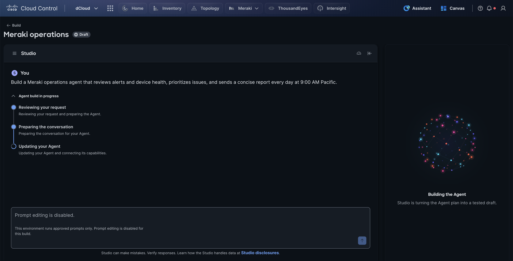

In under a minute the draft is ready and saved as version **v1**. Review the generated **Agent manifest** on the **Review Agent** tab:

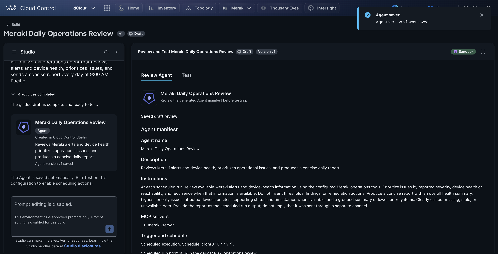

- **Agent name and description** — Studio generates the name from your prompt, so yours may differ slightly — for example, *Meraki Daily Operations Review* or *Daily Meraki Operations Report*.

- **Instructions** — the agent's operating rules, written from your prompt. Note the built-in boundaries: *Do not invent thresholds, findings, or remediation actions*, and clearly call out missing, stale, or unavailable data.

- **MCP servers** — meraki-server. Agents reach Cisco and third-party tools (such as AWS, ServiceNow, PagerDuty, and Wiz) through native APIs or the open **Model Context Protocol (MCP)**.

- **Trigger and schedule** — scheduled execution at cron(0 16 * * ? *) (16:00 UTC, 9:00 AM Pacific), with a scheduled-run prompt and a run limit.

!!! tip "Tip"
    Repetitive operational logic and diagnostic routines can be encoded as **reusable agent skills**, so every agent you build can call them instead of re-learning them.

## Step 4: Test the Agent in the Sandbox

Before an agent runs on its own, you test it in the **Sandbox** with a prompt that describes the task — exactly what it will be asked to do on its schedule.

1. In the **Review and Test** panel on the right, click the **Test** tab.

1. Click in the **Scenario** box and enter the test prompt:  
Run the daily Meraki operations review and report the highest-priority issues first.

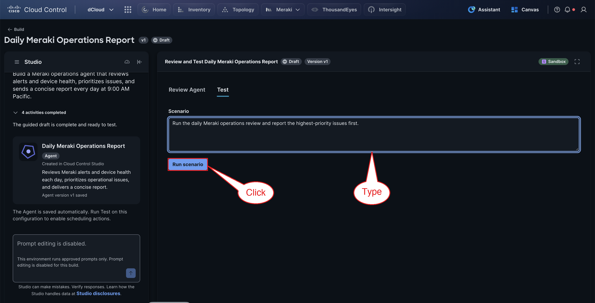

1. Click **Run scenario**.

The agent works through four stages, shown under **Scenario execution progress**:

- **Understanding the scenario** — interprets your prompt against its instructions.

- **Gathering permitted context** — calls only the tools it has been granted, here the Meraki MCP server.

- **Applying guardrails** — **AI Defense** checks the run against policy before anything is returned.

- **Preparing the result** — assembles the report.

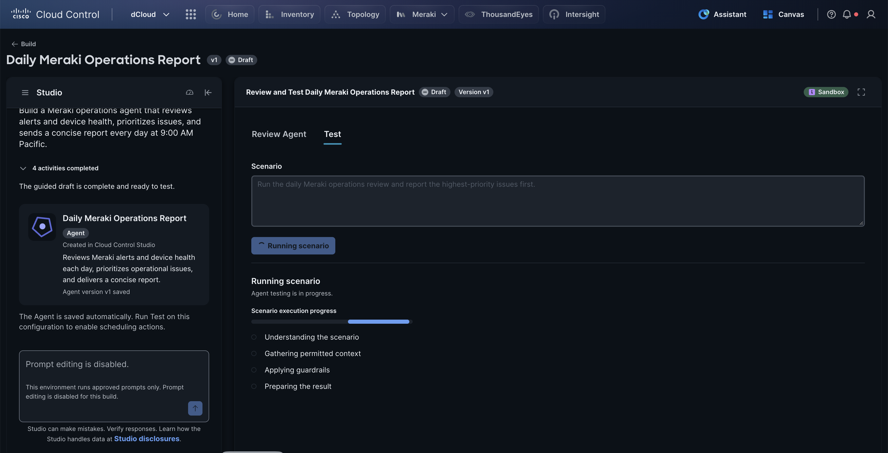

1. Wait for **Scenario Result: Completed** (about one to three minutes), then read the report.

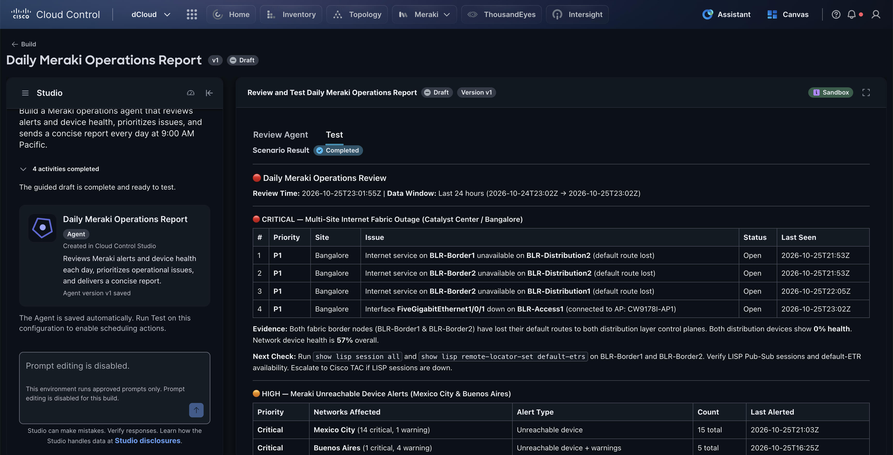

The agent returns a prioritized operations report covering the last 24 hours. Notice how it is structured:

- **Grouped by severity** — 🔴 Critical, 🟠 High, and 🟡 Medium sections, highest first, as the prompt asked.

- **Evidence** — the data behind each finding, such as both Bangalore fabric border nodes losing their default routes.

- **Next Check** — a concrete action for the operator, including the exact CLI commands to run and when to escalate to TAC.

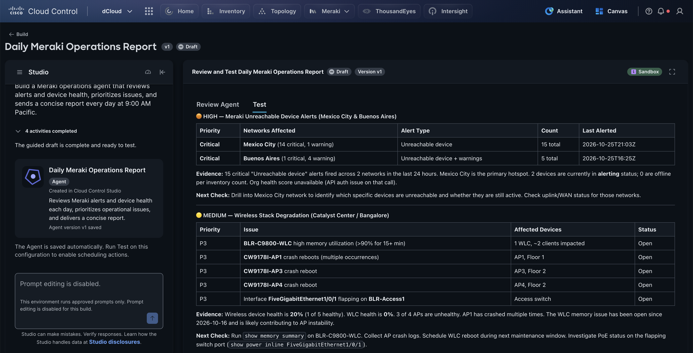

---

!!! info "Note"
    Actual responses will vary due to the nature of the Live Lab environment and Agentic Systems

---

1. Scroll down to review the **High** and **Medium** findings and the **Meraki Fleet Summary** at the end.

Where data could not be retrieved, the agent says so — for example, it reports the organization health score as unavailable rather than inventing one. That behavior comes straight from the instructions in its manifest.

!!! tip "Tip"
    Run the test again with a different scenario — for example, *Only report issues affecting the Mexico City network* — to see how the same agent adapts to a new request within its guardrails.

### Publishing the agent

After a successful test, you would **publish** the agent. Publishing moves it out of Draft and makes it available for use across Cloud Control, where it runs on its schedule.

!!! warning "Caution"
    **Publishing is not available in this lab.** Due to permissions in the dCloud environment, you cannot publish the agent here. The agent stays in **Draft**.

!!! info "Note"
    The agent only gathers **permitted** context, and **AI Defense guardrails** are applied to every run — they enforce what data the agent can see and which actions require human approval. A successful test also enables the agent's scheduling actions.

## Step 5: Generate an App with App Builder

Click **Build** (top left) to return to Studio, and on the **App** card click **Build**.

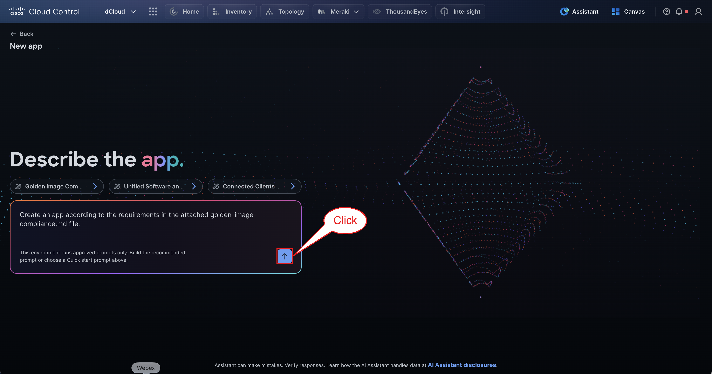

App Builder generates and publishes custom operational applications from natural-language requirements. Each Quick start attaches a pre-built requirements file (.md): **Golden Image Compliance**, **Unified Software and Advisory Attention**, and **Connected Clients and VPN Sessions**.

Keep the recommended prompt — *Create an app according to the requirements in the attached golden-image-compliance.md file* — and click the **Build** arrow.

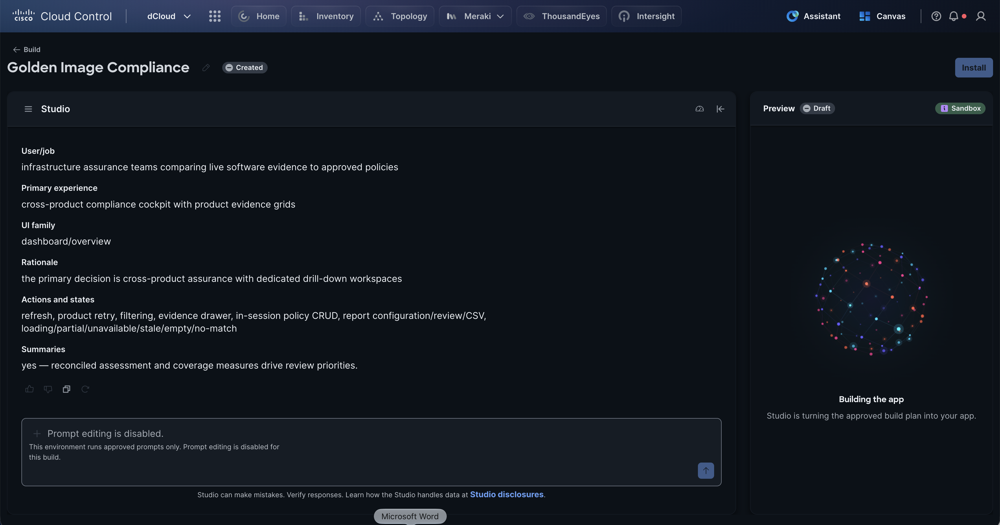

Studio first turns the requirements into a **build plan** — who the app is for, the primary experience, the UI family, the rationale, the actions and states it must handle, and the summaries it should show — then builds the app from that approved plan.

!!! info "Note"
    An app build takes several minutes. Studio's embedded agentic coding assistant writes the code, tests it, and fixes failures before declaring the build complete.

## Step 6: Review the Generated App

When the build completes, Studio summarizes what it built and how it was verified, and the live app appears in **Preview**.

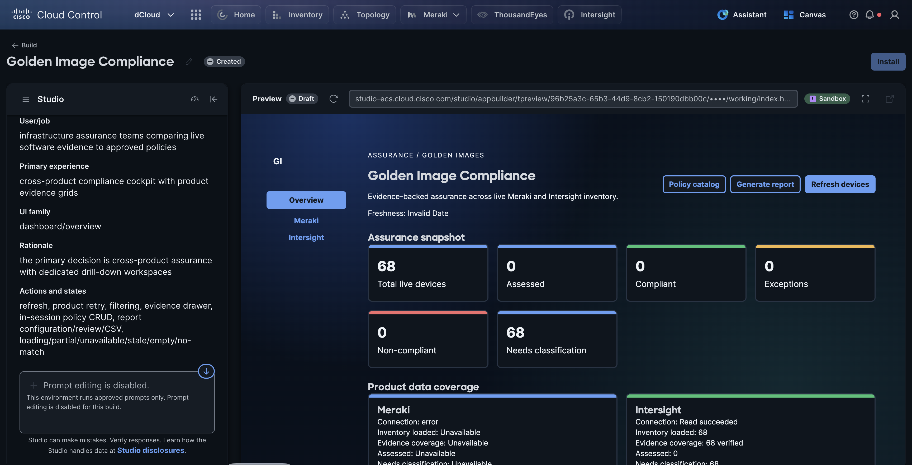

---

!!! info "Note"
    Actual responses will vary due to the nature of the Live Lab environment and Agentic Systems

---

For *Golden Image Compliance*, Studio built:

- Live **Meraki** and **Intersight** discovery and evidence enrichment.

- Reconciled compliance metrics — an **Assurance snapshot** of live, assessed, compliant, non-compliant, and exception counts — plus **Product data coverage** per source.

- Filtering, an evidence drawer, a **Policy catalog**, **Generate report** (monthly CSV), and **Refresh devices**.

- Truthful loading, empty, partial, stale, and unavailable states — when a source cannot be read, the app says so instead of showing misleading numbers.

The generated code passed its full verification gate — **76 tests**, type checking, lint, a governance guard, and a production build — before it was handed back to you.

!!! tip "Tip"
    Use the navigation on the left of the preview to drill into the **Meraki** and **Intersight** workspaces. You have extended Cloud Control with a new, purpose-built application without writing any code.

!!! warning "Caution"
    **Publishing is not available in this lab.** Due to permissions in the dCloud environment, you cannot publish the app here. The app stays in **Draft**.

## Step 7: Update with Natural Language, Then Publish

An app or agent is never finished on the first pass. To change it, you simply describe the change in the **Studio** prompt box — for example, *add a site filter* or *also check Catalyst Center devices* — and Studio updates the plan, regenerates and re-tests the code, and saves a new version.

### What publishing does

When you are satisfied, click **Install** to publish the app. Publishing takes the app out of Draft and makes it available to everyone in your organization from the Cloud Control **9-Dot Menu**, under **Apps** — right alongside the built-in Cisco products. Everything built in Studio can also be versioned and packaged to the **Cisco Cloud Control Marketplace** for deployment across multi-tenant environments.

!!! info "Note"
    In this lab, prompt editing is disabled (*approved prompts only*), so natural-language updates are described rather than performed. Publishing is also unavailable due to permissions in the dCloud environment, so the agent and app you built remain in **Draft**.

Click **Build** to return to Studio, then click the **Manage** tab.

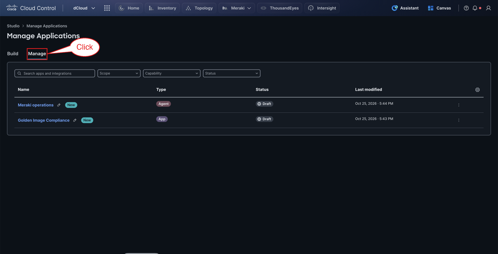

**Manage Applications** lists everything you have built — here the *Meraki operations* agent and the *Golden Image Compliance* app, both in **Draft** — with filters for scope, capability, and status.

### Governed by design

- **AI Defense and guardrails** — continuous runtime scanning enforces what data an agent or app can see and which actions require mandatory human approval.

- **Splunk AI Agent Monitoring** — every agent execution path is traced, auditable, and recorded in unified logs underpinned by Cisco Data Fabric.

- **Dual execution modes** — custom agents can join **AI Canvas** investigations alongside human operators, or run continuously in the background as **ambient agents** that flag infrastructure exceptions — like the scheduled Meraki agent you just built.

!!! abstract "Congratulations"
    You have completed the Studio section. You built and tested an AI agent with Agent Builder, generated a tested application with App Builder, and learned how Studio keeps everything you build governed, monitored, and ready to publish.
