# Section 6: Cloud Control and Cisco IQ

In this section, you will see how Cisco IQ and Cisco Cloud Control work together. Cisco IQ continuously assesses your Cisco estate for security advisories, configuration and hardening gaps, certificate expiry, and quantum readiness. When IQ is connected, those findings enrich the Cloud Control inventory right where operators already work, and a single click takes you to the exact device in Cisco IQ. You will follow one device from an inventory insight, through its IQ assessments, to an AI Canvas conversation that explains how to fix what IQ found.

## Step 1: Spot the Quantum Readiness Insight in Inventory

!!! warning "Caution"
    This is a live lab environment. The devices, counts, and findings you see will vary from the screenshots in this guide as data changes over time.

In the Cloud Control top bar, click **Inventory**.

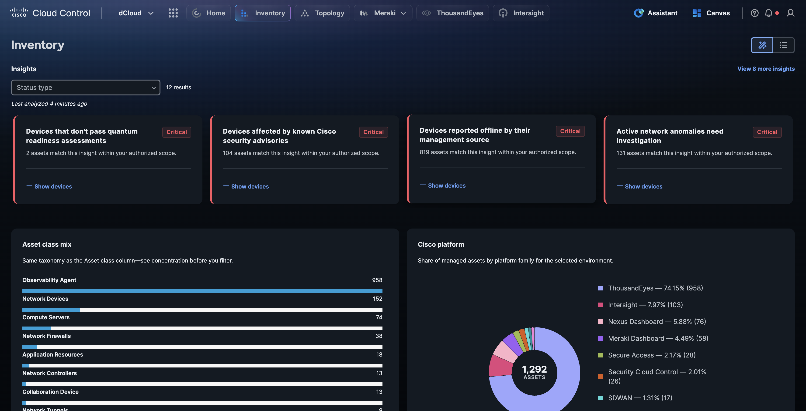

The **Insights** row surfaces the issues that matter most across every connected platform. Look for **Devices that don't pass quantum readiness assessments** — a *Critical* insight that comes from Cisco IQ, not from a network controller. Because IQ is connected, its assessment results show up here automatically.

## Step 2: Filter to the Affected Devices

On the quantum readiness insight card, click **Show devices**.

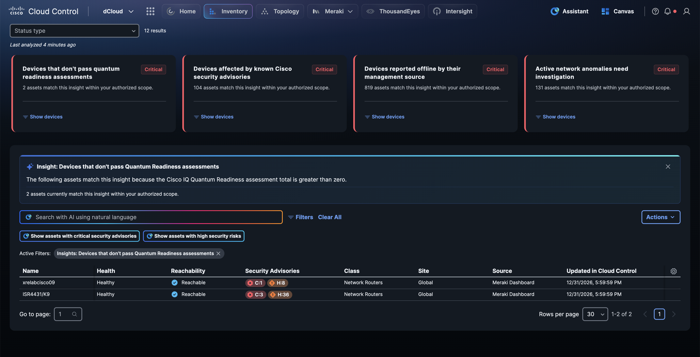

Inventory filters to the devices behind the insight and explains why they match: their Cisco IQ quantum readiness assessment total is greater than zero. The table already shows IQ data — note the **Security Advisories** column with critical (**C**) and high (**H**) counts per device.

!!! tip "Tip"
    You can also filter by describing what you want — use **Search with AI using natural language** above the table, or the suggested filters such as *Show assets with critical security advisories*.

## Step 3: Open the Device and Review Cisco IQ Enrichment

Click the **ISR4431/K9** router to open its information panel, then expand **Asset coverage and support**.

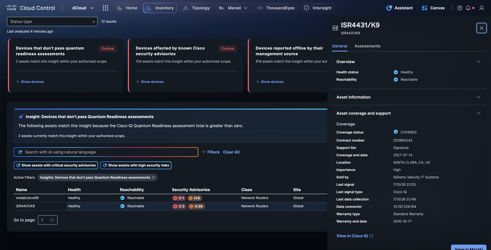

A controller can tell you whether a device is healthy and reachable. Cisco IQ adds the context a controller alone can't:

- **Coverage status**, **Contract number**, **Support tier** (here, *Signature*), and **Coverage end date**.

- **Warranty type** and **Warranty end date** — this router's standard warranty ended years ago.

- **Importance**, **Sold by** partner, and when IQ last collected data through its **Data connector**.

## Step 4: Review the Cisco IQ Assessments

In the device panel, click the **Assessments** tab.

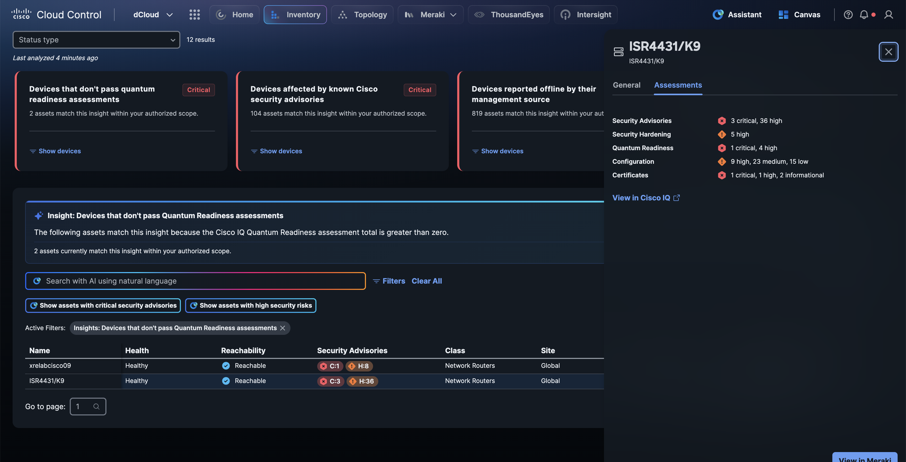

This is every Cisco IQ assessment for the device, summarized by severity:

- **Security Advisories** — known Cisco PSIRT advisories that affect this hardware and software.

- **Security Hardening** — configuration that weakens the device's security posture.

- **Quantum Readiness** — how prepared the device is for post-quantum cryptography.

- **Configuration** — deviations from Cisco configuration best practices.

- **Certificates** — expired and soon-to-expire certificates.

An operator sees all of this without leaving Cloud Control.

## Step 5: Cross-Launch into Cisco IQ

At the bottom of the Assessments tab, click **View in Cisco IQ**.

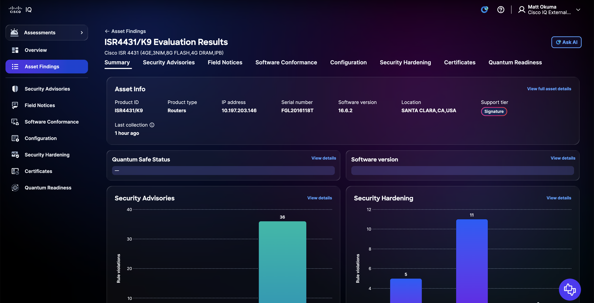

Cisco IQ opens directly on this device's **Asset Findings** page — no searching, and no second sign-in. The **Summary** tab shows the same asset details you saw in Cloud Control, plus charts for each assessment. The tabs across the top let you drill into any of them.

!!! info "Note"
    Cisco IQ is a separate service. If your lab login does not have Cisco IQ access, review the IQ screenshots in the next three steps instead, then continue with AI Canvas.

## Step 6: Investigate Quantum Readiness

Click the **Quantum Readiness** tab.

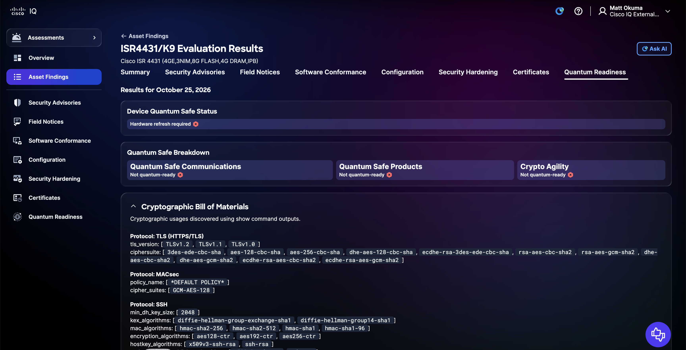

Quantum computing introduces two threats security teams are only beginning to plan for:

- **Harvest now, decrypt later** — encrypted traffic captured today and decrypted once a capable quantum computer exists.

- **Trust now, forge later** — the signatures behind today's hardware and software integrity checks, such as Secure Boot, could someday be forged to load malicious firmware.

Cisco IQ evaluates the device against three pillars — **Quantum Safe Communications**, **Quantum Safe Products**, and **Crypto Agility** — and gives an overall **Device Quantum Safe Status**. For this router it is *Hardware refresh required*. The **Cryptographic Bill of Materials** lists the TLS, MACsec, and SSH algorithms actually in use, discovered from show-command output.

!!! tip "Tip"
    Quantum readiness is a planning tool: it helps make sure the hardware bought this year won't need to be ripped out again in three.

## Step 7: Check Certificate Expiry and Security Hardening

Click the **Certificates** tab.

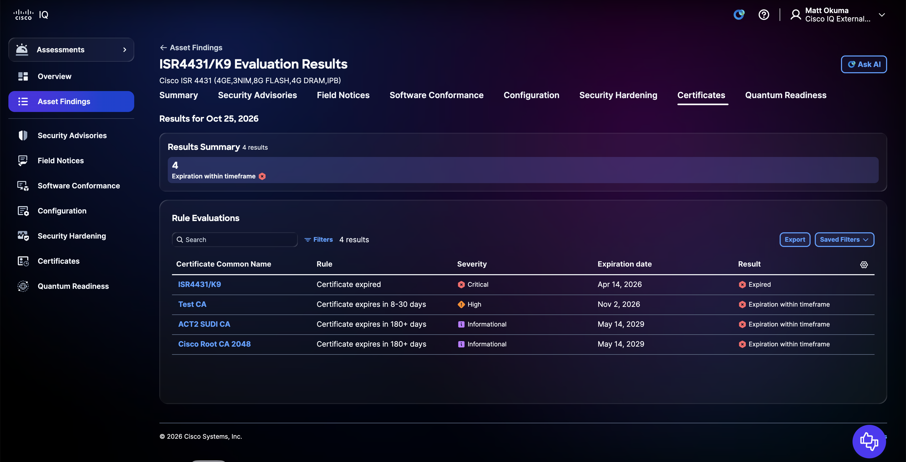

IQ analyzes every certificate on the device. Here, the device certificate has already **expired** (*Critical*) and a second expires within 30 days (*High*). On a VPN edge router, an expired certificate can take tunnels down — exactly the kind of 3 a.m. page a NOC wants to prevent.

Now click the **Security Hardening** tab.

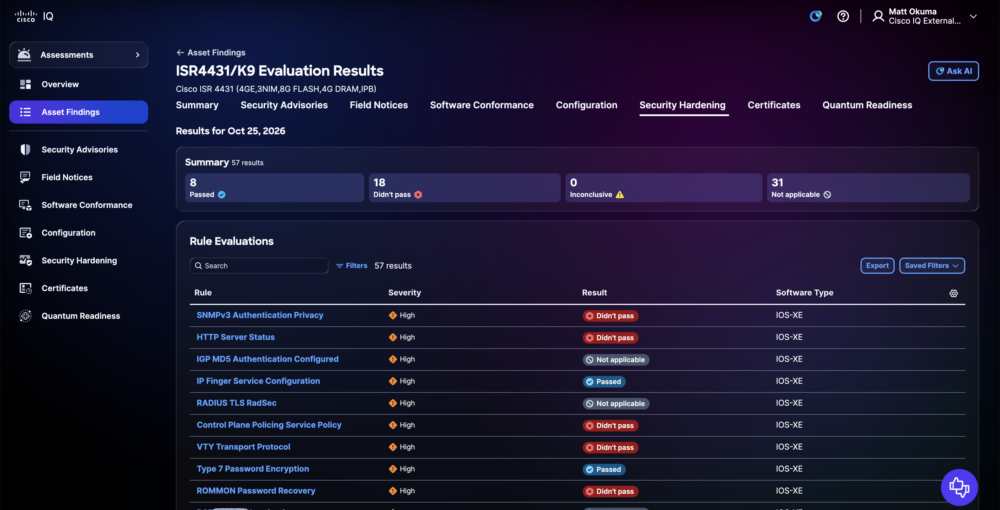

Every hardening rule is evaluated against the device's configuration and marked *Passed*, *Didn't pass*, *Inconclusive*, or *Not applicable*. Note **VTY Transport Protocol** — *Didn't pass*. You will fix it in the next steps, and because it can be changed in the same maintenance window as the certificate, one outage window closes two problems.

## Step 8: Ask AI Canvas About Hardening Opportunities

Return to Cloud Control (use the Cloud Control top bar or your browser's back button — you stay signed in). Click **Home**, open **Canvas**, and start a **New** canvas.

In the message box, enter:  
What security hardening opportunities are on ISR4431/K9?

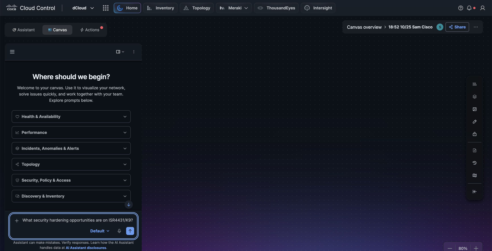

AI Canvas queries Cisco IQ's assessment data and adds a table to the canvas — the failing hardening findings for the device, summarized by severity, with each rule and what it found. No report to run and no configuration to read line by line.

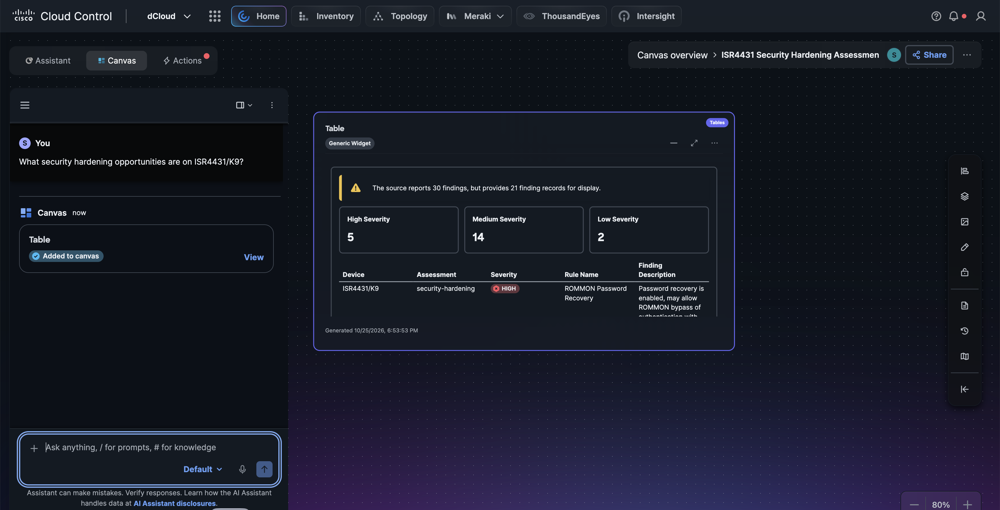

To read the whole table, hover over the table card and click **Enter fullscreen mode** (the expand icon at the top right of the card). The summary shows how many findings are High, Medium, and Low, and the rows are sorted by severity.

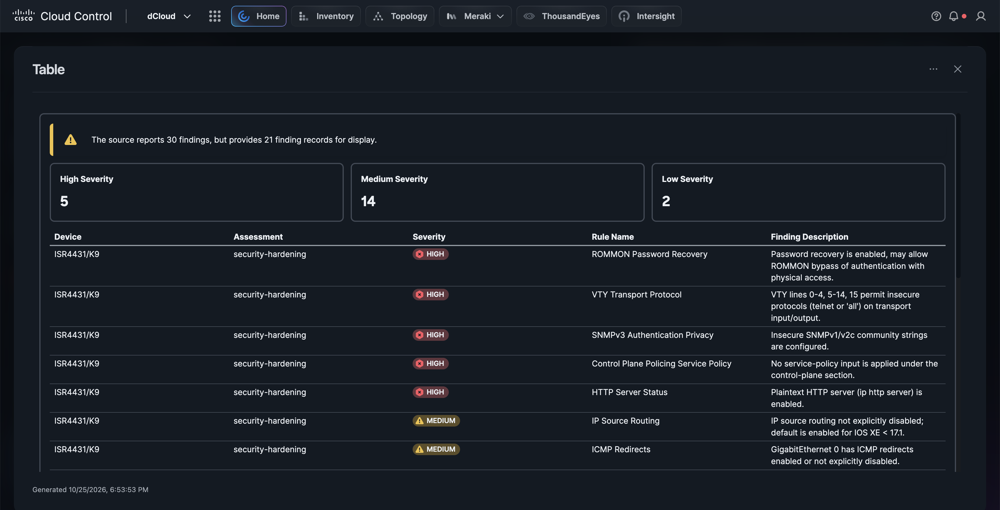

Scroll inside the table to see the Medium findings — logging, proxy ARP, enable secret, login banner, SSH version, and more.

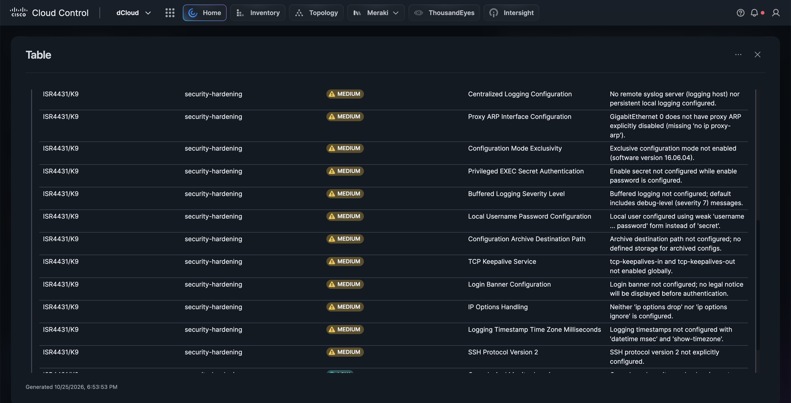

Scroll to the bottom for the remaining Medium and Low findings, then close fullscreen with the **X**.

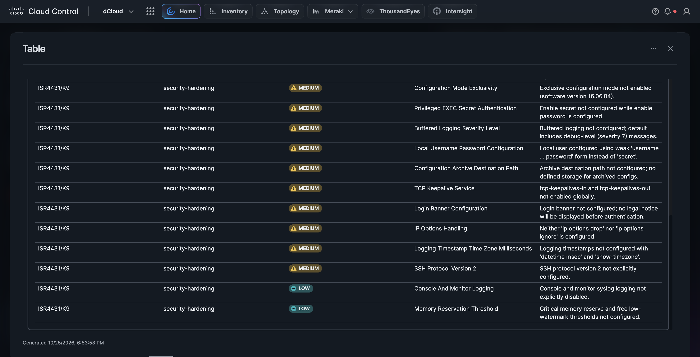

---

!!! info "Note"
    Actual responses will vary due to the nature of the Live Lab environment and Agentic Systems

---

## Step 9: Get Remediation Guidance in the Same Conversation

In the same canvas, ask:  
How do I harden VTY Transport Protocol on ISR4431/K9?

AI Canvas explains the finding before it gives a fix. It shows the rule's impact and description, then the **context of what was found** on this specific device — which VTY line ranges allow Telnet.

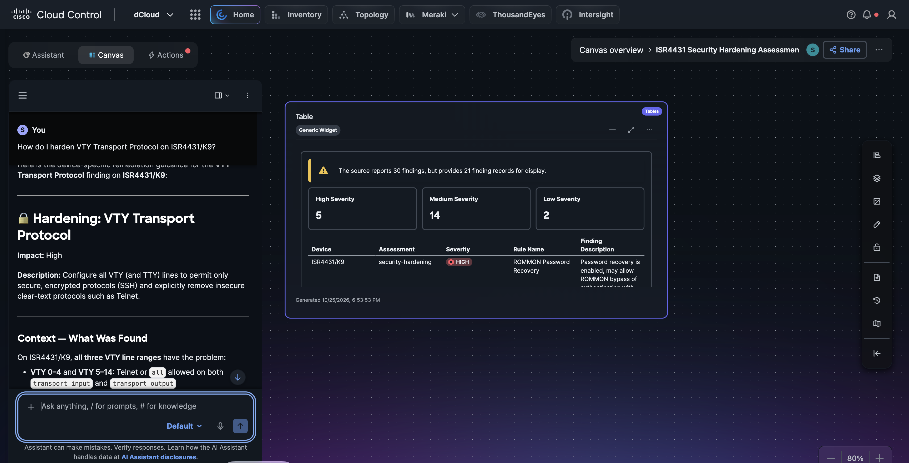

Scroll down. **Option 1** gives the Cisco-recommended commands to restrict every VTY range on this device to SSH only — already filled in with the device's actual line numbers.

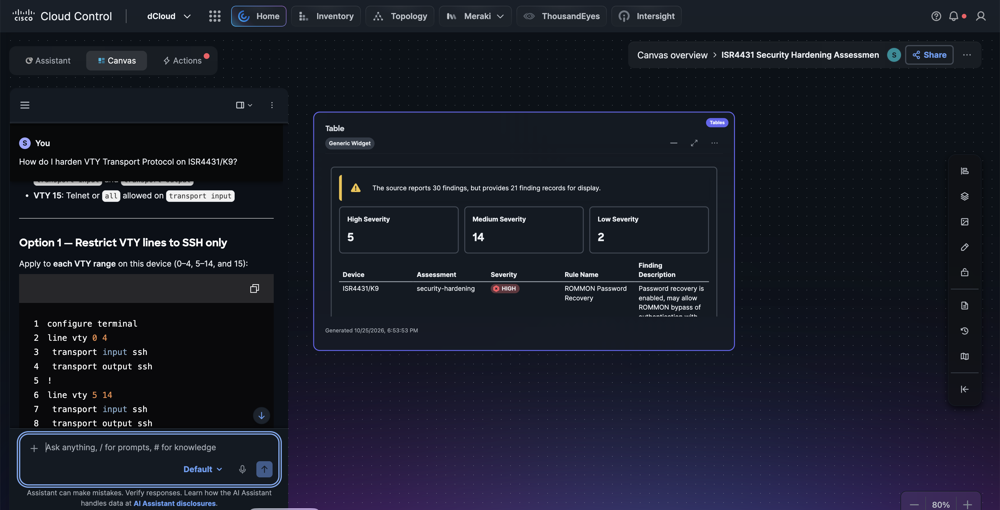

Keep scrolling. Option 1 finishes with VTY line 15, and **Option 2** begins — it covers TTY lines that aren't used for reverse-console connections.

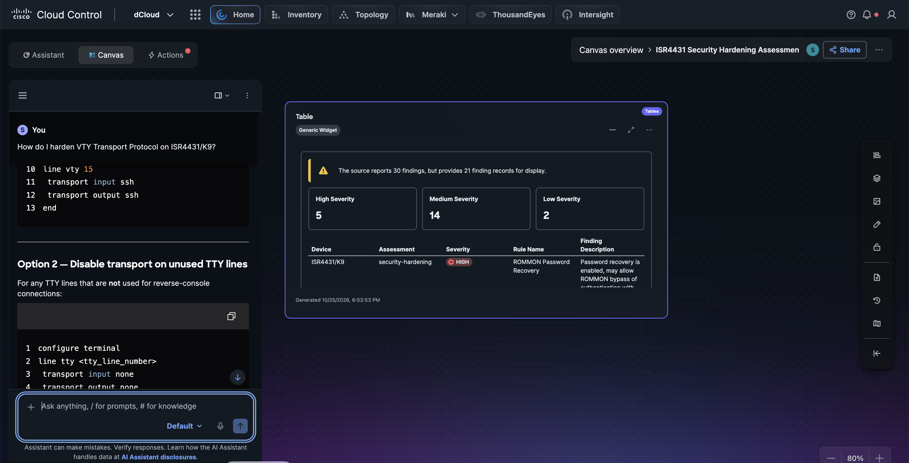

Scroll again to see the rest of Option 2, followed by **Important Notes** — for example, confirm SSH is configured before removing Telnet, or you could lose management access.

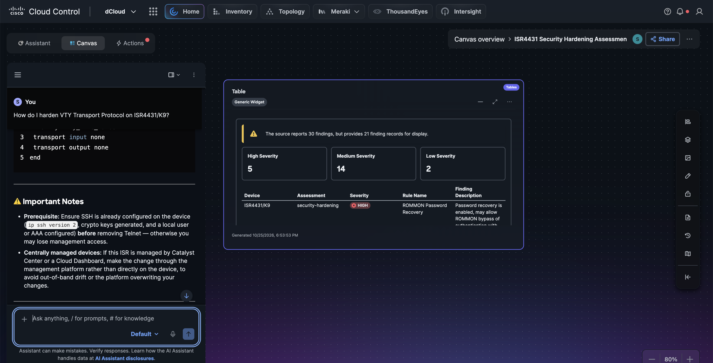

The response ends with a disclaimer and a link back to the Cisco IQ finding detail, and offers to help with the next high-severity finding.

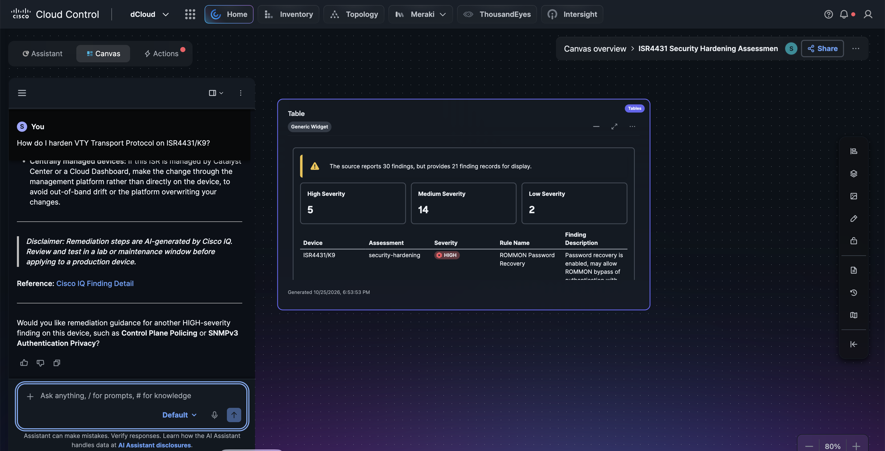

---

!!! info "Note"
    Actual responses will vary due to the nature of the Live Lab environment and Agentic Systems

---

!!! warning "Caution"
    Remediation steps are AI-generated. Review and test them in a lab or maintenance window before applying them to a production device. Do not apply configuration changes to devices in this lab.

### From guidance to action with Cisco Workflows

AI Canvas doesn't have to stop at guidance. Through an MCP integration with **Cisco Workflows**, it can hand the fix to an automation workflow. In the same canvas, ask:  
Can you execute the VTY line hardening workflow?

AI Canvas routes the request to the **Workflows Agent** (Beta). Expand **steps completed** to see which agent handled it. The agent responds with a **Review workflow** card for **VTY Configuration Hardening** — *Enforces SSH on VTY Lines* — listing exactly what the workflow will do before anything runs.

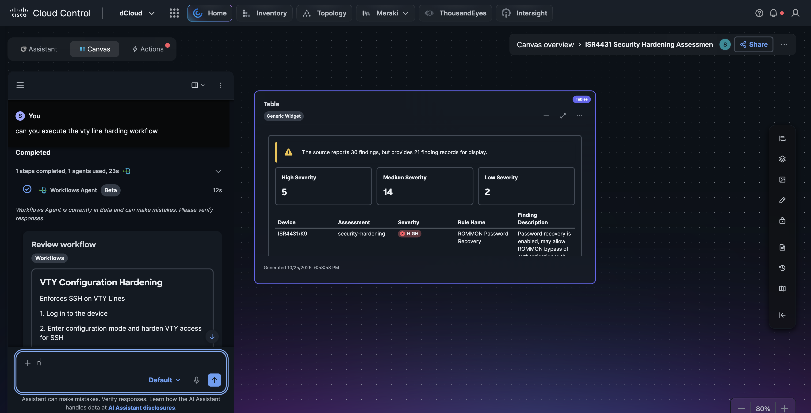

The workflow has three steps: **log in to the device**, **enter configuration mode and harden VTY access for SSH**, and **validate the VTY configuration**. Nothing changes until an operator clicks **Initiate workflow** — the human stays in control of every change.

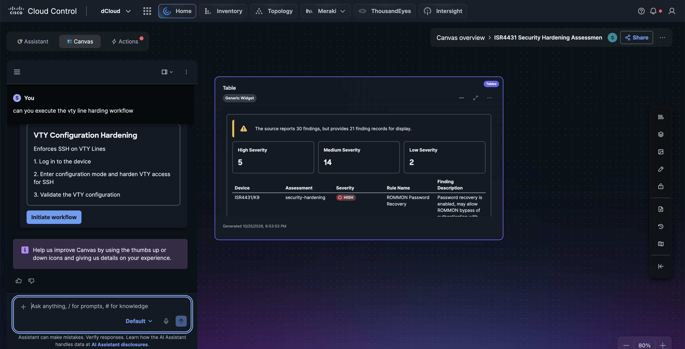

!!! warning "Caution"
    **Running workflows is not available in this lab.** This is a limitation of the dCloud lab environment, not of the product: lab accounts are not given permission to execute automated workflows, and this access is not available on request. When you click **Initiate workflow**, the Workflows Agent returns an access-denied response, and no change is made to the device.

    In a customer's own Cloud Control tenant, users who have been granted workflow permissions can click **Initiate workflow** and the workflow runs end to end — logging in to the device, applying the SSH-only VTY configuration, and validating the result.

Click **Initiate workflow** anyway to see how the agent handles it. AI Canvas sends *Yes, proceed with workflow "VTY Configuration Hardening"* on your behalf, and the Workflows Agent checks your permissions before it touches the device.

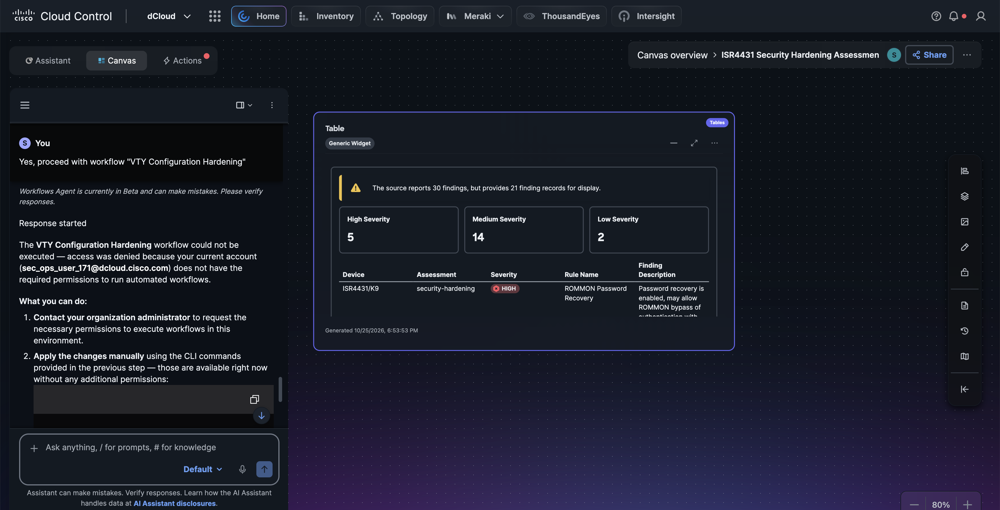

The agent stops and explains why the workflow couldn't run. Its suggested next steps include contacting an administrator for workflow permissions — **ignore that suggestion in this lab**. Workflow execution is not available to lab accounts in the dCloud environment, and no one needs to request it. The response also repeats the commands it already generated for this device, which is how an operator would apply the change manually.

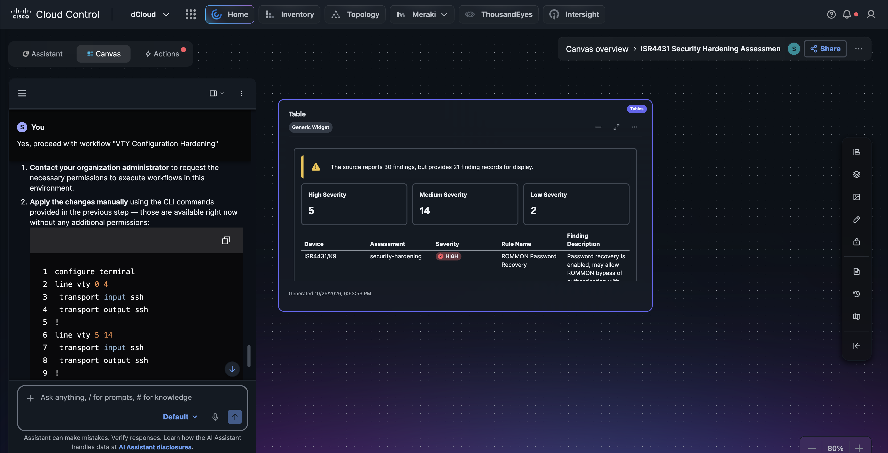

The response ends with the full SSH-only VTY configuration for this device and offers to help with the next high-severity finding.

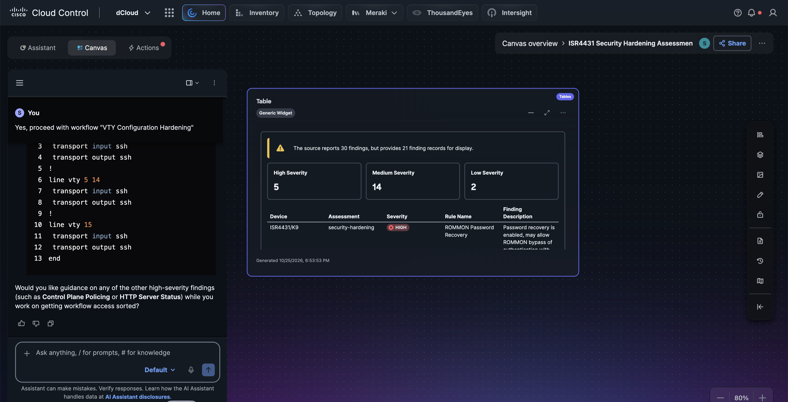

This is the governance model at work: the agent can find, explain, and propose a fix, but it only executes a change when the person asking has permission to make it. In a production tenant with workflow access, the same click runs the three workflow steps and validates the result.

---

!!! info "Note"
    Actual responses will vary due to the nature of the Live Lab environment and Agentic Systems

---

In one conversation you went from *what's wrong*, to *how to fix it*, to *an approved, repeatable workflow that applies the fix* — without opening another tool or a CLI session. You can also **Share** the canvas with your on-call operations team so they can review the change before it runs.

!!! abstract "Congratulations"
    You have completed the Cloud Control and Cisco IQ section. You followed a device from an inventory insight to its Cisco IQ assessments, planned for a long-term quantum readiness risk, and used AI Canvas to understand and fix today's hardening risk in a single conversation.
